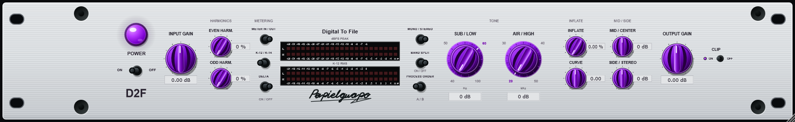
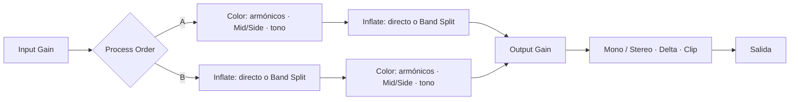

<div align="center">

# PAPIELGUAPO · D2F
### Digital To File
**Armónicos · Tono · Inflado · Monitorización**


[**Descargar para Windows**](https://github.com/papielguapo/PAPIELGUAPO-D2F/releases) · [Guía de controles](#guía-de-controles) · [Medidores](#dos-medidores-estéreo) · [Auditoría](#mediciones-y-límites)



</div>

D2F es un procesador VST3 de mastering que combina **armónicos, tono, Mid/Side e inflado de densidad** en una interfaz de rack. Sus dos etapas —Color e Inflate— pueden intercambiarse. Permite trabajar en banda completa o por bandas, comprobar la mezcla en mono y escuchar la diferencia que introduce el procesamiento.

El frontal alto, de estética 2U, conserva el metal, los mandos violetas, la lámpara y la firma de PAPIELGUAPO. Los controles están centrados dentro de los cuatro tornillos negros, con Effect/Curve y Mid/Side apilados. El diseño es una referencia visual para una futura unidad física; esta entrega es un plugin de software.

> **Ganancia completamente manual.** D2F no normaliza la entrada, no iguala automáticamente el volumen de salida y no intenta llevar el audio a 0 dBK. Las escalas K son únicamente medidores.

## Guía de controles

### Ganancia y etapa Color

| Control del frontal | Función | Rango / manejo |
|---|---|---|
| **Input Gain** | Ajusta el nivel que entra en la primera etapa de la cadena. También cambia cuánto se excitan los armónicos y el inflado. | −24 a +24 dB. Doble clic: 0 dB. |
| **Even Harm.** | Regula los armónicos pares de la etapa Color. | 0 a 100 %, en pasos del 1 %. |
| **Odd Harm.** | Regula los armónicos impares de la etapa Color. | 0 a 100 %, en pasos del 1 %. |
| **Air / High** | Realza la zona alta con su respuesta de realce. | Knob central: 0 a +10 dB. Aro exterior: 20 / 30 / 40 / 50 kHz. |
| **Sub / Low** | Realza la zona baja con su respuesta de realce. | Knob central: 0 a +10 dB. Aro exterior: 40 / 50 / 60 / 100 Hz. |
| **Mid / Center** | Ajusta el componente común a L y R: el centro de la imagen estéreo. | −20 a +20 dB. Arriba del mando Side. |
| **Side / Stereo** | Ajusta el componente de diferencia entre L y R: la información lateral. Puede cambiar anchura y nivel; no es una panoramización. | −20 a +20 dB. Debajo de Mid. |

Los aros de Air/Sub son selectores de frecuencia independientes del knob central. No cambian su ganancia al girarlos. Dentro de Color, los armónicos preceden a la matriz Mid/Side y después se aplican Air/Sub; la posición gráfica de Mid/Side en el frontal no cambia ese orden interno.

### Inflator y salida

| Control del frontal | Función | Rango / manejo |
|---|---|---|
| **Inflate** — Effect | Mezcla la cantidad de waveshaping con la señal de esa etapa. | 0 a 100 %. Mando superior. |
| **Curve** | Modifica el carácter y la distribución del inflado. Su efecto depende del nivel y del contenido del audio. | −50 a +50. Mando inferior. |
| **Output Gain** | Ajusta la ganancia final después de las dos etapas, independientemente del orden A/B. | −24 a +24 dB. Doble clic: 0 dB. |
| **Clip** | Recorta únicamente la salida que supera ±1, después de Output. Sin recorte previo ni saturación suave añadida. | Interruptor **ON / OFF**, con LED violeta. El LED indica que la función está activada. |

**Effect a 0 %** elimina la contribución del waveshaping, pero no desactiva Color ni la protección de rango interno de la etapa Inflate. No equivale al bypass completo del plugin.

**Clip es duro:** conserva exactamente las muestras entre −1 y +1, y fija en −1/+1 las que exceden el techo. El recorte genera distorsión en los picos que elimina; no añade un modo de saturación ni suaviza la curva. Delta permite escuchar también la diferencia del recorte y mantiene su propio techo de monitorización.

Con **Power activo y Clip ON**, ninguna muestra de salida supera 0 dBFS, también con Output al máximo, Mono o Delta. Es un techo **por muestras**, no un limitador true peak: no garantiza que los picos reconstruidos entre muestras queden por debajo de 0 dBTP.

### Selección, orden y escucha

| Interruptor | Posiciones | Qué cambia |
|---|---|---|
| **Power** | ON / OFF | Activa el procesamiento o deja pasar la entrada original, compensando las 38 muestras de latencia. La lámpara violeta muestra el estado. El bypass no recorta el audio original. |
| **Meter In / Out** | IN / OUT | Elige la señal de los dos medidores: entrada tras Input Gain o salida final, incluida la escucha Mono/Delta. No cambia el audio. |
| **K-12 / K-14** | K-12 / K-14 | Cambia exclusivamente la referencia del medidor RMS inferior. El medidor superior sigue mostrando picos dBFS. |
| **Delta Monitor** | ON / OFF | Permite escuchar **salida procesada menos entrada original**, con la entrada alineada en tiempo. No aplica ganancia automática al residual. |
| **Mono / Stereo** | MONO / STEREO | En Mono, suma L y R a partes iguales y envía el resultado a ambos canales. En estéreo mantiene la separación original. |
| **Band Split** | ON / OFF | ON: Inflator procesa tres bandas complementarias. OFF: procesa la banda completa. No es procesamiento Mid/Side. |
| **Process Order** | **A / B** | A: Color → Inflate. B: Inflate → Color. A/B selecciona **orden**, no dos memorias de preset. |

Delta usa la entrada original anterior a Input Gain, por lo que también permite oír las diferencias de ganancia. Con Mono activo, la comparación se hace en mono. Clip sigue protegiendo la salida de monitorización cuando está activado. El sobremuestreo y la respuesta de Color pueden producir un residual incluso con los mandos de efecto a cero.

## Dos órdenes, una misma ganancia final



Input Gain siempre está al principio y Output Gain siempre después de ambas etapas. Al cambiar A/B cambia qué señal recibe cada procesador: con ajustes no neutros, los dos órdenes pueden sonar y medir de forma distinta.

Band Split utiliza divisiones de **240 Hz y 2,4 kHz**, con la compensación correspondiente de la banda media. El aro Air de Color es otro control y no modifica esos cruces.

## Dos medidores estéreo

| Medidor | Lectura | Canales |
|---|---|---|
| **Superior — dBFS Peak** | Picos digitales. 0 dBFS corresponde a una amplitud de ±1. | L arriba y R abajo, independientes. |
| **Inferior — K-12 / K-14 RMS** | Nivel medio con referencia seleccionable. Detector exponencial de 600 ms. | L arriba y R abajo, independientes. |

IN/OUT selecciona la misma fuente en ambos medidores. El último segmento de cada canal indica que se ha alcanzado 0 dBFS de pico. Ese indicador es independiente del LED del interruptor Clip.

| Referencia | Señal sinusoidal que marca 0 dBK | RMS matemático de esa señal |
|---|---|---|
| **K-12** | Seno de −12 dBFS de pico, calibración AES17. | −15,0103 dBFS RMS. |
| **K-14** | Seno de −14 dBFS de pico, calibración AES17. | −17,0103 dBFS RMS. |

Cambiar de K-12 a K-14 desplaza la lectura en 2 dB; **no amplifica, atenúa ni normaliza** la señal. Un máster musical no tiene una relación fija entre RMS y pico como la de un seno.

## Primera prueba

1. Empieza con Input/Output y Mid/Side a 0 dB; Even/Odd, Air/Sub e Inflate a cero.
2. Selecciona **A**, estéreo, Band Split OFF y Delta OFF. Deja Clip ON si necesitas el techo digital.
3. Ajusta armónicos y tono. Sube Inflate y prueba Curve con el material reproduciéndose.
4. Compensa el nivel con Output Gain antes de decidir por volumen percibido.
5. Comprueba Mono y Delta, y compara A/B y Band Split. Devuelve Delta a OFF para escuchar la salida procesada normal.

## Instalar en Windows

Descarga el ZIP de la versión desde [Releases](https://github.com/papielguapo/PAPIELGUAPO-D2F/releases) y copia **la carpeta completa** `PAPIELGUAPO - D2F.vst3` en:

```text
C:\Program Files\Common Files\VST3
```

Cierra el DAW antes de sustituir una versión cargada y vuelve a escanear VST3 al abrirlo. D2F funciona de forma autónoma dentro del DAW, sin cargar otros plugins.

| Característica | Implementación |
|---|---|
| Formato | VST3, Windows x64. |
| Audio | Mono y estéreo, procesamiento float de 32 bits. |
| Etapa Color | Sobremuestreo FIR 4×. |
| Latencia declarada | 38 muestras en ambos órdenes. |
| Ventana | Redimensionable, proporción fija. Se abre en 817 × 126; admite hasta 3268 × 504. |
| Automatización y estado | Parámetros automatizables y estado guardado por el host. |

La identidad VST3 se conserva respecto a PHOBOS 67. Mantén una sola versión de esa identidad instalada. Mid/Side reutiliza sus IDs antiguos: revisa sesiones que guardasen valores no neutros cuando esos controles estaban inactivos. El antiguo selector dBFS/K-12 pasa a seleccionar K-12/K-14, con picos digitales siempre visibles arriba.

## Validación y funcionamiento

D2F se comprueba con pruebas de procesamiento, ganancia, medidores, estado e interfaz. Los logs funcionales se encuentran en [Validation](Validation).

- Procesamiento mono y estéreo, bloques variables y salida finita.
- Ganancias manuales y selectores de medidor que no cambian el audio.
- Mono, Delta, Band Split y cambio de orden A/B.
- Techo de Clip también con ganancia máxima y en las rutas de monitorización.
- Estado persistente, automatización y comprobación de memoria en el procesamiento.
- Protección numérica de los filtros a frecuencias de muestreo altas.

El techo de Clip se refiere a muestras digitales; no es un limitador true peak. La escucha Delta incluye las diferencias de ganancia y se compara con la entrada original alineada en tiempo.

<details>
<summary><strong>Compilar y ejecutar las comprobaciones</strong></summary>

Requisitos: CMake 3.22+, compilador C++17 y JUCE 9.0.4 obtenido por separado. Los nombres internos de los targets se conservan.

```powershell
cmake -S . -B build -G "Visual Studio 18 2026" -A x64 -DPHOBOS67_JUCE_PATH="C:/ruta/JUCE"
cmake --build build --config Release --target Phobos67_VST3 Phobos67Check --parallel
```

| Comando del validador | Comprueba |
|---|---|
| `Phobos67Check` | Formatos, bloques, silencio, salida finita y estado. |
| `Phobos67Check --levels` | Ganancias manuales y ausencia de auto gain. |
| `Phobos67Check --functional` | Clip, bypass, medidores L/R, Mono, Delta, Band Split, orden, M/S, automatización, estado y asignaciones de memoria. |
| `Phobos67Check --ui` | Posiciones, vínculos de controles, aros de frecuencia, escalado y apertura al mínimo. |

Las comprobaciones funcionales del proyecto se ejecutan con el validador incluido.

</details>

## Licencia

[GNU AGPL v3](LICENSE). JUCE se obtiene y licencia por separado según las condiciones aplicables. El diseño de un futuro equipo híbrido analógico/digital es una línea de desarrollo independiente de esta versión VST3.

<div align="center">

**Diseñado y firmado por PAPIELGUAPO**

</div>
